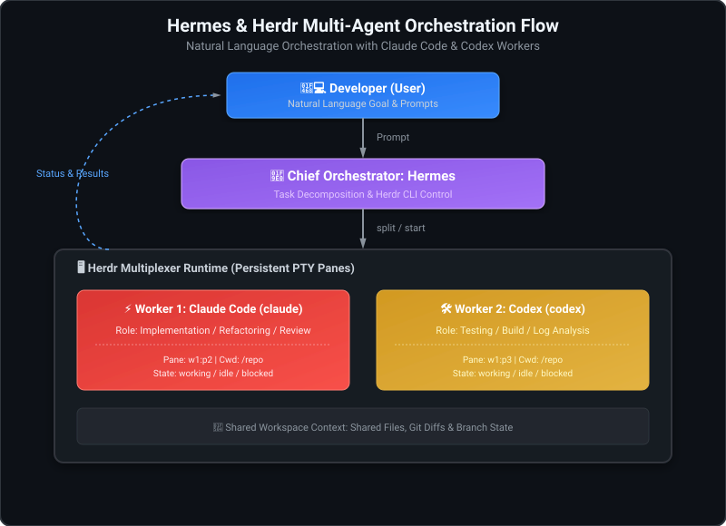
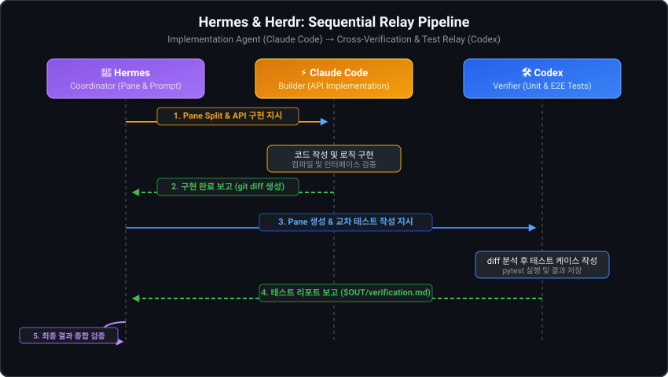
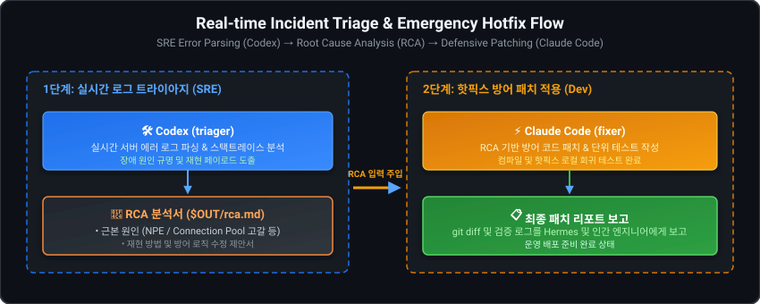

이전 글 [Herdr 완벽 가이드: AI 코딩 에이전트를 위한 터미널 멀티플렉서](/devops/herdr-ai-agent-terminal-multiplexer-guide/)에서 에이전트 인식형 터미널 런타임인 **Herdr**의 기본 개념과 CLI 명령어 구조를 살펴보았습니다.

하지만 개발자가 터미널에서 패널을 쪼개고, 에이전트 프로세스를 하나하나 띄우며 CLI 명령어를 직접 타이핑하는 것은 여전히 많은 수작업을 요구합니다. 우리가 궁극적으로 지향하는 작업 환경은 **"오케스트레이터 에이전트에게 사람에게 말하듯 목표를 던지면, 오케스트레이터가 하위 작업자 에이전트들을 적재적소에 배치하고 협업을 지휘하는 구조"**입니다.

이 글에서는 **Hermes Agent**를 총괄 오케스트레이터로 두고, 실제 코딩과 테스트를 수행하는 작업자로 **Claude Code(`claude`)**와 **Codex(`codex`)**를 배치하여 Herdr 환경에서 자연어로 멀티 에이전트를 지휘하는 실전 시나리오 5가지를 정리합니다. 복잡한 CLI 절차를 나열하지 않고 사람에게 일을 맡기듯 지시하는 자연어 프롬프트와, 그 이면에서 Hermes가 Herdr를 제어하는 내부 동작 방식을 함께 살펴봅니다.



---

## 사전 준비 (Prerequisites)

오케스트레이터인 Hermes가 Herdr 터미널 멀티플렉서를 자유자재로 제어하려면 먼저 Herdr와 Hermes 간의 연동 설정이 필요합니다.

```bash
# 1. Hermes 상태를 herdr가 정확히 감지하도록 연동 (herdr 공식 지원)
herdr integration install hermes

# 2. 오케스트레이터용 pane에서 Hermes 시작
orch_pane=$(herdr pane split --current --direction down --no-focus | jq -r '.result.pane.pane_id')
herdr agent start orchestrator --kind hermes --pane "$orch_pane"
```

이후 Hermes에게 아래에서 소개하는 프롬프트를 전달합니다. 전달은 직접 Hermes 패널에 입력해도 되고, 외부 스크립트나 터미널에서 `herdr agent prompt orchestrator "..."`로 주입해도 무방합니다.

> [!NOTE]
> **Hermes에게 herdr 도구 인식시키기**  
> Hermes가 자연어 프롬프트만으로 herdr를 다루려면 herdr CLI의 사용법과 파라미터를 인지하고 있어야 합니다. 따라서 프롬프트 첫머리에 항상 **"herdr CLI를 사용해서"**를 명시해야 합니다.  
> 보다 안정적인 도구 호출을 위해 [Herdr Agent Skill File](https://herdr.dev/tui/docs/agent-skill/) 문서를 Hermes의 스킬(Skill)이나 시스템 컨텍스트에 등록해 두는 것을 권장합니다.

---

## 1. 간단한 작업 1개 위임

가장 기본적인 패턴으로, 코드 변경 사항을 검토할 독립적인 리뷰어 에이전트를 띄우고 결과를 보고받는 시나리오입니다.

### CLI (Hermes가 내부적으로 실행하게 될 명령)

```bash
pane=$(herdr pane split --current --direction right --no-focus | jq -r '.result.pane.pane_id')
herdr agent start reviewer --kind claude --pane "$pane"
herdr agent prompt reviewer "현재 git diff를 리뷰하고 버그 가능성만 정리해줘" --wait --timeout 120000
herdr agent read reviewer --source recent-unwrapped --lines 120
```

### Hermes 프롬프트 (자연어)

```text
herdr를 사용해서 Claude Code 에이전트 하나를 "reviewer"라는 이름으로 띄워줘.
내 옆에 새 pane을 열어서 실행하되, 화면 포커스는 뺏지 마.

reviewer에게는 "현재 git diff를 리뷰하고 버그 가능성이 있는 부분만 정리해줘"라고 시키고,
작업이 끝날 때까지 기다린 다음 결과를 나에게 알려줘.

만약 reviewer가 승인이나 질문 때문에 멈추면, 임의로 승인하지 말고
화면에 뭐가 떠 있는지 먼저 보여줘.
```

---

## 2. 작업 2개를 각각 다른 에이전트에게 위임 (병렬 실행)

서로 의존성이 없는 두 개의 작업을 각기 다른 모델/도구의 장점에 맞춰 동시에 병렬로 분배하는 시나리오입니다.

### CLI

```bash
p1=$(herdr pane split --current --direction right --no-focus | jq -r '.result.pane.pane_id')
p2=$(herdr pane split "$p1" --direction down --no-focus   | jq -r '.result.pane.pane_id')

herdr agent start backend --kind claude --pane "$p1"
herdr agent start tester  --kind codex  --pane "$p2"

herdr agent prompt backend "src/api의 N+1 쿼리를 찾아 수정해줘" --wait --timeout 600000 &
herdr agent prompt tester  "tests/ 에 로그인 실패 케이스 단위 테스트를 추가해줘" --wait --timeout 600000 &
wait
```

### Hermes 프롬프트 (자연어)

```text
herdr로 에이전트 두 개를 띄워서 일을 나눠 맡겨줘. 두 작업은 서로 독립적이니까 동시에 진행시켜.

- "backend": Claude Code로 실행. src/api 코드에서 N+1 쿼리를 찾아서 고치게 해줘.
- "tester": Codex로 실행. tests/ 폴더에 로그인 실패 케이스 단위 테스트를 추가하게 해줘.

각자 별도 pane에서 돌리고, 둘 다 끝나면 알려줘.
이 단계에서는 결과 내용을 요약하지 말고, 각 에이전트가 어떤 상태로 끝났는지
(정상 완료 / 승인 대기 / 시간 초과 등)만 보고해줘.

한쪽이 에러나 타임아웃으로 끝났다면, 같은 지시를 다시 보내기 전에
먼저 그 에이전트 화면을 확인해서 지시가 이미 전달됐는지 확인해줘.
```

---

## 3. 2개 위임 → 결과 확인 → 결과 기준 요약 (파일 기반 집약)

두 에이전트가 각자 분석한 결과를 직접 터미널 버퍼로 읽으면 UI 잡음이나 ANSI 이스케이프 코드가 섞여 해석 오류가 발생하기 쉽습니다. 임시 디렉터리에 마크다운 파일로 결과를 출력하게 한 뒤 이를 바탕으로 종합 요약 보고서를 도출하는 모범 패턴입니다.

### CLI

```bash
OUT=$(mktemp -d)

p1=$(herdr pane split --current --direction right --no-focus | jq -r '.result.pane.pane_id')
p2=$(herdr pane split "$p1" --direction down --no-focus   | jq -r '.result.pane.pane_id')

herdr agent start backend --kind claude --pane "$p1"
herdr agent start tester  --kind codex  --pane "$p2"

herdr agent prompt backend \
  "src/api의 N+1 쿼리를 분석만 해줘(수정 금지). 위치/원인/수정안을 $OUT/backend.md 에 저장하고 파일 경로만 답해." \
  --wait --timeout 600000 &
herdr agent prompt tester \
  "tests/ 를 실행하고 실패 목록과 원인 추정을 $OUT/tester.md 에 저장한 뒤 파일 경로만 답해." \
  --wait --timeout 600000 &
wait

herdr agent get backend | jq '.result.agent'
herdr agent get tester  | jq '.result.agent'
cat "$OUT/backend.md" "$OUT/tester.md"
```

### Hermes 프롬프트 (자연어)

```text
herdr로 에이전트 두 개에게 조사를 맡기고, 결과를 모아서 요약해줘.

먼저 임시 폴더를 하나 만들어서 결과 저장용으로 써.

- "backend" (Claude Code): src/api의 N+1 쿼리를 분석만 하게 해줘. 코드는 수정하지 말고,
  발견 위치, 원인, 수정안을 임시 폴더의 backend.md에 저장한 뒤 파일 경로만 답하게 해줘.
- "tester" (Codex): tests/ 전체를 실행해서 실패한 테스트 목록과 원인 추정을
  임시 폴더의 tester.md에 저장한 뒤 파일 경로만 답하게 해줘.

두 작업은 동시에 진행시키고, 둘 다 끝날 때까지 기다려.

끝나면 먼저 두 에이전트가 정상적으로 마무리됐는지 확인해줘.
승인 대기나 시간 초과 같은 문제가 있으면 요약하지 말고 어떤 문제인지 먼저 알려줘.

문제가 없다면 backend.md와 tester.md를 직접 읽고, 그 내용만 근거로 요약해줘.
파일에 없는 내용은 추측하지 말고, 파일이 비어 있거나 없으면 성공으로 보지 말고 알려줘.

요약은 아래 순서로 정리해줘.
1. 두 결과를 관통하는 공통 원인이나 서로 연관된 발견
2. backend와 tester 각각의 핵심 결과 (각 3줄 이내)
3. 우선순위별 후속 조치
4. 확인하지 못한 부분
```

### 선택: 요약도 별도 에이전트에게 맡기는 경우

Hermes 본인의 컨텍스트 윈도우 부담을 줄이고 대규모 문서를 다루기 위해 요약 전담 에이전트를 추가로 배치할 수 있습니다.

```text
요약은 네가 직접 하지 말고, 새 Claude Code 에이전트 "summarizer"를 하나 더 띄워서 맡겨줘.
summarizer에게 backend.md와 tester.md를 읽고 공통 원인과 우선순위별 조치 계획으로
요약해서 summary.md에 저장하게 한 다음, 그 파일 내용을 나에게 전달해줘.
```

---

## 4. [추가 사례 A] 순차 파이프라인: 구현 에이전트 → 교차 검증 & 테스트 릴레이

단순 병렬 처리가 아니라, 한 에이전트의 산출물이 완료된 후 이를 입력으로 받아 다른 에이전트가 검증하는 **순차 릴레이(Sequential Relay)** 패턴입니다. 구현 에이전트가 작성한 코드에 대한 편향을 제거하기 위해 검증은 별도의 에이전트(Codex)가 전담합니다.



### CLI

```bash
OUT=$(mktemp -d)

# 1단계: 구현 에이전트 실행 및 완료 대기
p_build=$(herdr pane split --current --direction right --no-focus | jq -r '.result.pane.pane_id')
herdr agent start builder --kind claude --pane "$p_build"
herdr agent prompt builder \
  "src/auth 모듈에 Refresh Token 회전(Rotation) API를 구현하고 커밋 없이 빌드 확인까지만 완료해줘" \
  --wait --timeout 600000

# 2단계: 검증 에이전트 실행 및 테스트 주입
p_verify=$(herdr pane split "$p_build" --direction down --no-focus | jq -r '.result.pane.pane_id')
herdr agent start verifier --kind codex --pane "$p_verify"
herdr agent prompt verifier \
  "git diff로 변경된 인증 로직을 확인하고, tests/auth에 정상/예외 케이스 테스트를 추가하여 실행해줘. 결과를 $OUT/verification.md에 저장하고 파일 경로만 답해." \
  --wait --timeout 600000

# 3단계: 검증 결과 확인
cat "$OUT/verification.md"
```

### Hermes 프롬프트 (자연어)

```text
herdr를 사용해서 기능 구현과 교차 검증을 순차적으로 진행해줘.

1단계:
우선 우측에 새 pane을 열고 Claude Code로 "builder" 에이전트를 띄워줘 (포커스는 유지).
builder에게 "src/auth 모듈에 Refresh Token 회전(Rotation) 로직을 구현하고 빌드 성공 여부만 확인해줘"라고 시켜.
builder가 완전히 끝날 때까지 기다려. 중간에 질문이나 확인 대기(blocked) 상태가 되면 임의로 넘기지 말고 나에게 물어봐.

2단계:
builder가 정상적으로 작업을 끝내면, 그 아래에 새 pane을 열어 Codex로 "verifier" 에이전트를 띄워줘.
verifier에게는 "현재 워크스페이스의 git diff를 확인하고, 새로 추가된 토큰 로직에 대해 통과/실패 시나리오 테스트를 tests/auth에 작성한 뒤 pytest를 돌려줘. 테스트 결과와 실패 원인을 임시 폴더의 verification.md에 저장하고 경로만 알려줘"라고 지시해.

verifier 작업이 끝나면 verification.md를 확인해서 모든 테스트가 통과했는지, 실패한 케이스가 있다면 무엇인지 정리해서 나에게 보고해줘.
```

---

## 5. [추가 사례 B] 실시간 장애 트라이아지 & 긴급 핫픽스 (SRE 분석 + 패치)

운영 환경이나 스테이징에서 에러가 폭증할 때 유용한 패턴입니다. 로그를 역추적해 장애 원인을 규명(RCA)하는 에이전트와, 그 분석 결과를 기반으로 방어 로직 패치를 적용하는 에이전트를 긴밀하게 연계합니다.



### CLI

```bash
OUT=$(mktemp -d)

# 1단계: 원인 분석 에이전트(Codex)로 RCA 생성
p_triage=$(herdr pane split --current --direction right --no-focus | jq -r '.result.pane.pane_id')
herdr agent start triager --kind codex --pane "$p_triage"
herdr agent prompt triager \
  "logs/app.log 의 500 에러 스택트레이스를 분석해서 근본 원인과 재현 페이로드를 $OUT/rca.md 에 정리하고 경로만 답해." \
  --wait --timeout 300000

# 2단계: 핫픽스 개발 에이전트(Claude Code)로 패치 작성
p_fix=$(herdr pane split "$p_triage" --direction down --no-focus | jq -r '.result.pane.pane_id')
herdr agent start fixer --kind claude --pane "$p_fix"
herdr agent prompt fixer \
  "$OUT/rca.md 를 읽고 src/payment/ 에 Null 체크 방어 코드를 작성한 뒤 컴파일과 단위 테스트를 실행해줘. 패치 요약을 $OUT/patch.md 에 저장하고 경로만 답해." \
  --wait --timeout 600000

cat "$OUT/patch.md"
```

### Hermes 프롬프트 (자연어)

```text
herdr를 사용해서 장애 트라이아지와 핫픽스 패치 작업을 연계해줘.
결과 교환을 위해 임시 폴더를 먼저 하나 생성해둬.

1. 먼저 우측 pane에 Codex로 "triager" 에이전트를 띄워줘.
   triager에게 "logs/app.log의 최근 500 Internal Server Error 스택트레이스를 역추적해서
   NPE가 발생한 지점, 원인, 그리고 재현 가능한 입력 페이로드를 임시 폴더의 rca.md에 작성해줘"라고 지시해.

2. triager가 작성을 완료하고 rca.md가 정상 생성되면, 그 아래 pane에 Claude Code로 "fixer" 에이전트를 띄워줘.
   fixer에게는 "임시 폴더의 rca.md를 읽고 결제 모듈(src/payment/)에 방어 로직을 적용해줘.
   수정 후 기존 단위 테스트를 실행해서 회귀 버그가 없는지 확인하고, 수정한 파일과 로직 요약을 patch.md에 기록해줘"라고 지시해.

3. 두 에이전트 모두 작업이 완료되면, triager의 원인 분석과 fixer의 패치 내용을 취합해서
   - 장애 근본 원인 (1줄)
   - 패치된 파일 및 변경 내용
   - 테스트 통과 여부
   순으로 간결하게 보고해줘.
```

---

## 프롬프트를 쓸 때 유의할 점 (Best Practices)

오케스트레이터에게 자연어로 업무를 위임할 때 아래 5가지 원칙을 지키면 실패 확률을 크게 낮추고 예측 가능한 협업 환경을 만들 수 있습니다.

> [!IMPORTANT]
> 1. **에이전트 이름과 종류(`kind`)를 명확히 지정**  
>    `"backend (Claude Code)"`, `"tester (Codex)"`처럼 모델과 에이전트 종류를 명시해야 Hermes가 herdr 내부에서 `--kind claude`, `--kind codex`로 정확하게 매핑합니다.
>
> 2. **결과는 화면 버퍼 대신 임시 파일(`$OUT`)로 수집**  
>    터미널 화면을 직접 스크랩(read)하면 터미널 색상 코드, 프롬프트 깜빡임, 진행 바(progress bar) 등 UI 노이즈가 섞입니다. `"결과를 임시 폴더의 result.md에 기록하고 경로만 답해"`라는 지침을 주면 노이즈 없는 순수 마크다운 결과만 수집할 수 있습니다.
>
> 3. **승인 대기(`blocked`) 처리 규칙 명시**  
>    에이전트가 파일 수정이나 패키지 설치 시 확인(y/n)을 물어볼 수 있습니다. `"임의로 승인하지 말고 화면에 뭐가 떠 있는지 먼저 보여줘"`라는 규칙을 프롬프트에 넣어두면 Hermes가 위험한 작업을 독단적으로 승인하는 사고를 방지할 수 있습니다.
>
> 4. **타임아웃 시 무조건 재전송 금지 (화면 선확인 원칙)**  
>    네트워크 지연이나 모델 생각 시간이 길어져 타임아웃이 나더라도 백그라운드에서는 프롬프트가 이미 전달되어 열심히 작업 중일 수 있습니다. `"다시 보내기 전에 먼저 화면을 확인해서 지시가 전달됐는지 봐줘"`를 포함해 중복 작업과 레이스 컨디션을 방지하세요.
>
> 5. **포커스 탈취 방지 (`--no-focus`) 지시**  
>    작업자가 백그라운드에서 패널을 띄울 때 현재 사용자가 타이핑 중인 화면 포커스를 빼앗기면 작업 흐름이 끊깁니다. `"화면 포커스는 뺏지 마"`라는 지시를 포함하면 Hermes가 `--no-focus` 플래그를 누락 없이 사용합니다.

---

## 마무리

터미널 멀티플렉서의 발전은 단순한 '화면 분할 도구'를 넘어 **'AI 에이전트 간의 통신 버스이자 협업 런타임'**으로 진화하고 있습니다.

Herdr가 제공하는 강력한 프로세스 모니터링 및 패널 I/O 인프라 위에, Hermes라는 자율 코디네이터가 결합됨으로써 개발자는 마이크로 매니징(CLI 명령어 타이핑)에서 벗어나 **고수준의 아키텍처 설계와 최종 의사결정**에만 집중할 수 있게 되었습니다.

위에서 소개한 패턴들을 기반으로 자신만의 에이전트 팀 토폴로지를 구성해 보시기 바랍니다.
