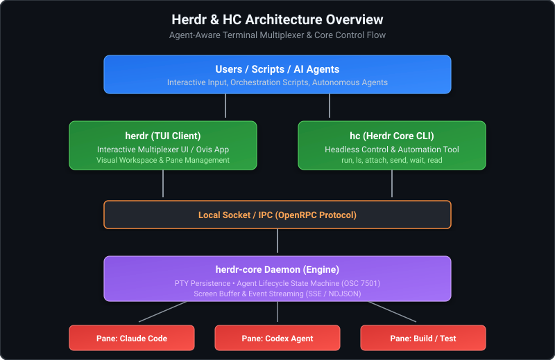

[Herdr 완벽 가이드](/devops/herdr-ai-agent-terminal-multiplexer-guide/)에서 살펴보았듯, **Herdr**는 Claude Code, Codex, Cursor CLI 등 여러 AI 코딩 에이전트를 동시에 실행하고 라이프사이클을 추적할 수 있도록 설계된 차세대 에이전트 인식형(Agent-Aware) 터미널 멀티플렉서입니다.

Herdr를 사용할 때 터미널 TUI(`herdr`) 화면에서 패널을 직접 나누고 작업할 수도 있지만, CI/CD 자동화 파이프라인이나 오케스트레이터 에이전트 스크립트, 혹은 헤드리스(Headless) 환경에서 진가를 발휘하는 도구는 바로 백그라운드 런타임 전용 CLI인 **`hc` (Herdr Core CLI)**입니다.

이 글에서는 `hc` 명령어의 정의와 핵심 아키텍처, 그리고 `run`, `ls`, `attach`, `send`, `wait` 등 터미널 및 에이전트 관리에 필요한 주요 기능과 실전 활용 예시를 상세히 정리합니다.

---

## 1. `hc` 명령의 정의와 아키텍처

### `hc`란 무엇인가?

`hc`는 **Herdr 백그라운드 엔진(`herdr-core`)과 통신하여 터미널(PTY) 세션을 생성·제어·모니터링하는 공식 커맨드라인 인터페이스**입니다.



기존의 `tmux`가 클라이언트와 서버가 단일 실행 파일(`tmux`)로 결합되어 대화형 키 바인딩 위주로 운용되었다면, Herdr는 **시각적 UI(`herdr` TUI 또는 데스크톱 Ovis)**와 **엔진 제어 인터페이스(`hc`)**를 명확히 분리했습니다.

### Herdr 아키텍처 관점에서 본 HC의 본질

Herdr 생태계를 깊이 이해하려면 먼저 **"우리가 매일 터미널에서 실행하는 화려한 `herdr` TUI 화면 역시 본질적으로는 하나의 클라이언트에 불과하다"**는 사실을 인지해야 합니다.

* **TUI(`herdr`)는 단지 뷰(View) 레이어일 뿐입니다:**  
  우리가 화면을 분할하고 에이전트의 실시간 상태 바를 보며 작업하는 대화형 TUI 애플리케이션(`herdr`)이나 데스크톱 앱(Ovis)은 백그라운드에서 동작하는 `herdr-core` 데몬과 로컬 소켓(OpenRPC)을 통해 통신하는 **수많은 클라이언트 중 하나**일 뿐입니다. TUI 창을 강제로 닫거나 크래시가 나더라도 코어 엔진과 터미널 세션에는 아무런 영향이 없습니다.
* **`hc`는 코어 데몬과 직접 대화하는 가장 원초적인 제어 인터페이스입니다:**  
  시각적 렌더링이나 복잡한 사용자 인터랙션 레이어를 모두 걷어내고, 백그라운드 `herdr-core` 데몬과 직접 통신하는 순수한 제어 파이프라인이 바로 `hc`(Herdr Core CLI)입니다.
* **완벽한 대등성과 확장성:**  
  `herdr` TUI에서 누르는 패널 생성, 세션 포커스, 입력 전송 등의 모든 동작은 내부적으로 `herdr-core`의 소켓 API를 호출하는 것과 같습니다. 따라서 개발자나 스크립트, 혹은 자율 에이전트가 `hc` 명령을 내리는 것은 TUI가 수행하는 작업과 **완전히 동등한 레벨의 원초적이고 강력한 제어권**을 행사하는 셈입니다.

결과적으로 `hc`는 단순한 유틸리티 보조 도구가 아니라, Herdr라는 분산형 터미널 아키텍처의 심장부(`herdr-core`)를 스크립트와 AI 에이전트가 직접 다룰 수 있도록 열어둔 **최상위 코어 제어 허브**입니다.

### `hc`의 핵심 강점

1. **PTY 세션의 완전한 영속성 (Process Persistence)**  
   터미널 윈도우를 닫거나 SSH 연결이 끊겨도, `herdr-core` 데몬이 살아있는 한 실행 중인 에이전트와 빌드 작업은 죽지 않고 백그라운드에서 계속 동작합니다.
2. **에이전트 상태 인식 (Agent Lifecycle Awareness)**  
   출력 스트림 분석과 시퀀스(OSC 7501) 감지를 통해 프로세스가 단순히 돌아가고 있는지(`working`), 사용자 입력을 기다리는지(`blocked`), 작업을 끝마쳤는지(`done`), 대기 중인지(`idle`)를 상태 머신으로 추적합니다.
3. **기계 친화적(Machine-Friendly) 자동화 인터페이스**  
   `tmux send-keys`나 정규식 파싱 같은 불안정한 방식 대신, 명확한 서브커맨드와 JSON 출력을 지원하여 셸 스크립트뿐 아니라 **AI 에이전트가 스스로 다른 하위 에이전트를 스폰하고 결과를 기다리는 구조**를 손쉽게 구현할 수 있습니다.
4. **무중단 런타임 업그레이드 (`hc update`)**  
   실행 중인 터미널과 에이전트 프로세스를 강제로 재시작하지 않고도 백그라운드 코어 데몬만 최신 버전으로 안전하게 업데이트할 수 있습니다.

---

## 2. `hc` 핵심 서브커맨드 요약

| 명령어 | 설명 | 주요 옵션 / 파라미터 |
| :--- | :--- | :--- |
| **`hc run <command>`** | 백그라운드 또는 포그라운드에서 새 터미널 프로세스 실행 | `--bg` (백그라운드), `--name <이름>`, `--cwd <경로>` |
| **`hc ls`** | 현재 실행 중인 터미널 세션 및 에이전트 상태 목록 조회 | `--json` (JSON 포맷 출력), `--filter <상태>` |
| **`hc attach <target>`** | 실행 중인 백그라운드 터미널 화면으로 직접 전환(Attach) | 대상 터미널 ID 또는 이름 지정 (`Ctrl + \`로 분리) |
| **`hc send <target> <text>`** | 특정 에이전트/터미널 세션의 입력 스트림에 텍스트 주입 | 엔터(`\n`) 자동 포함 여부 제어 가능 |
| **`hc wait <target>`** | 에이전트 작업 완료(`done`) 또는 블록(`blocked`) 시점까지 대기 | `--timeout <초/ms>`, `--until <상태>` |
| **`hc read <target>`** | 터미널 버퍼의 최근 출력 텍스트 읽기 | `--lines <숫자>`, `--plain` (ANSI 제거) |
| **`hc events`** | 에이전트 상태 변경 이벤트를 실시간 SSE/NDJSON 스트림으로 구독 | 터미널 상태 감시 및 외부 웹훅 연동용 |
| **`hc kill <target>`** | 특정 터미널 프로세스 강제 종료 | 세션 및 하위 프로세스 정리 |
| **`hc update`** | 실행 중인 터미널 프로세스를 유지한 채 `herdr-core` 데몬 갱신 | 무중단 핫 리로드 |
| **`hc --skill`** | AI 에이전트 컨텍스트에 주입할 `hc` 매뉴얼/스킬 스펙 출력 | Agentic 프롬프트 연동용 |

---

## 3. 주요 명령어 상세 및 실전 예시

### 1) `hc run`: 백그라운드 터미널/에이전트 실행

명령어나 스크립트, AI 에이전트 CLI를 영속 터미널 내에서 구동합니다.

#### 기본 포그라운드 실행
```bash
# 터미널을 실행하고 완료될 때까지 기다림
hc run "pnpm build"
```

#### 백그라운드 비동기 실행 (`--bg`)과 이름 지정 (`--name`)
오케스트레이션에서 가장 많이 쓰이는 패턴입니다. 명령을 실행하자마자 백그라운드로 넘기고 터미널 식별자를 반환받습니다.

```bash
# Claude Code 에이전트를 백그라운드 세션으로 실행
hc run --bg --name reviewer "claude 'src/index.ts 코드 리뷰하고 수정안 제안해줘'"

# 특정 작업 디렉토리 지정
hc run --bg --name api-worker --cwd ./packages/backend "codex 'REST API 엔드포인트 테스트 작성'"
```

> [!TIP]
> `--name` 옵션을 지정하면 임의 생성되는 세션 ID(UUID 형태) 대신 사람이 읽기 쉽고 스크립트에서 참조하기 편한 고유 명칭으로 터미널을 제어할 수 있습니다.

---

### 2) `hc ls`: 터미널 및 에이전트 상태 조회

현재 관리 중인 모든 터미널의 목록과 실시간 상태를 확인합니다.

```bash
hc ls
```

**출력 예시:**
```text
ID          NAME        AGENT       STATUS      CWD                   COMMAND
term-101    reviewer    claude      ⚡ working  ~/dev/my-project      claude 'src/index.ts ...'
term-102    api-worker  codex       ⏸️ blocked  ~/dev/my-project/api  codex 'REST API ...'
term-103    db-migrate  bash        ✅ done     ~/dev/my-project      pnpm prisma migrate deploy
```

#### JSON 포맷을 활용한 스크립팅 (`--json`)
`jq`와 조합하면 상태별 필터링이나 조건부 자동화가 매우 간결해집니다.

```bash
# 사용자 승인이 필요한(blocked) 에이전트 목록만 추출
hc ls --json | jq '.[] | select(.status == "blocked") | {name: .name, id: .id}'

# 완료된(done) 에이전트 개수 카운트
hc ls --json | jq '[.[] | select(.status == "done")] | length'
```

---

### 3) `hc attach`: 세션 접속 및 분리

백그라운드에서 돌아가는 에이전트가 어떤 상태인지 직접 터미널 화면을 열어보고 싶을 때 사용합니다.

```bash
hc attach reviewer
```

- 터미널에 접속하면 PTY 화면이 연결되어 에이전트의 실시간 토큰 생성 화면, 프롬프트 입력창을 그대로 볼 수 있습니다.
- 작업을 확인한 후 **에이전트를 종료하지 않고 다시 백그라운드로 빠져나오려면 단축키 `Ctrl + \`**를 누릅니다. (`tmux`의 `Ctrl + b` `d`와 동일한 탈출 역할을 합니다.)

---

### 4) `hc send`: 프롬프트 및 명령 주입 (Steering)

`attach`로 터미널에 직접 들어가지 않고도, 외부 셸이나 다른 스크립트에서 실행 중인 에이전트에 지시문이나 입력을 주입할 수 있습니다.

```bash
# reviewer 에이전트에게 추가 요구사항 전달
hc send reviewer "추가로 테스트 코드 작성도 포함해줘"

# 승인 대기(blocked) 상태인 에이전트에 엔터 또는 'y' 전송
hc send api-worker "y"
```

터미널 내부의 에이전트는 환경변수 `$HC_TERMINAL_ID`를 참조하여 자신이 속한 터미널 번호를 알 수 있습니다. 따라서 에이전트가 작업 완료 후 다른 마스터 에이전트에게 보고할 때도 이 명령을 역으로 활용할 수 있습니다:

```bash
# 에이전트 내부 스크립트에서 메인 컨트롤러로 완료 메시지 보고
hc send orchestrator-term "Task completed successfully: see reports/audit.log"
```

---

### 5) `hc wait`: 비동기 작업 동기화 및 블록 감지

배치 스크립트나 다중 에이전트 파이프라인에서 가장 강력한 기능입니다. 에이전트가 작업을 마칠 때까지 스크립트 실행을 일시 정지(Pause)합니다.

```bash
# reviewer 세션의 작업이 끝날 때까지 대기
hc wait reviewer

# 최대 3분(180초) 동안만 대기하고 타임아웃
hc wait reviewer --timeout 180s
```

`--until` 옵션을 지정하면 `done`(완료)뿐 아니라 `blocked`(인간의 승인 대기) 상태로 전환되는 순간 대기를 해제하여 즉각 알림을 발송하도록 구성할 수 있습니다:

```bash
# 에이전트가 결정을 내리지 못하고 입력을 기다리는 상태가 되면 즉시 반환
hc wait api-worker --until blocked
echo "🚨 에이전트가 사용자 승인을 기다리고 있습니다!"
```

---

### 6) `hc read`: 터미널 화면 출력 버퍼 읽기

에이전트가 최종적으로 도출한 결과 요약이나 에러 로그를 텍스트로 가져옵니다.

```bash
# 최근 30줄의 출력 내용 읽기
hc read reviewer --lines 30

# 터미널 ANSI 컬러 코드를 제거하고 순수 텍스트만 추출
hc read reviewer --lines 50 --plain
```

---

## 4. 실전 자동화 파이프라인 시나리오

`hc`의 명령어들을 조합하면 다음과 같은 고도화된 멀티 에이전트 CI/CD 및 개발 자동화 워크플로우를 셸 스크립트 몇 줄로 작성할 수 있습니다.

### 시나리오: 기능 개발(Claude)과 단위 테스트(Codex) 병렬 실행 후 자동 병합

```bash
#!/usr/bin/env bash
set -euo pipefail

echo "🚀 [1/4] 두 개의 AI 에이전트를 백그라운드에서 병렬 시작합니다..."

# 1. Claude Code에게 비즈니스 로직 작성 위임
hc run --bg --name agent-impl \
  --cwd ./services/order \
  "claude '주문 취소 기능(CancelOrder) 비즈니스 로직을 구현해줘'"

# 2. Codex에게 테스트 케이스 작성 위임
hc run --bg --name agent-test \
  --cwd ./services/order \
  "codex '주문 취소 시 결제 환불 Mock 단위 테스트 케이스를 tests/ 에 작성해줘'"

# 3. 작업 현황 확인
hc ls

echo "⏳ [2/4] 두 에이전트가 작업을 완료할 때까지 대기합니다..."
hc wait agent-impl --timeout 300s
hc wait agent-test --timeout 300s

echo "📋 [3/4] 에이전트별 최종 작업 요약 읽기..."
echo "--- [구현 에이전트 출력] ---"
hc read agent-impl --lines 15 --plain

echo "--- [테스트 에이전트 출력] ---"
hc read agent-test --lines 15 --plain

echo "🧪 [4/4] 전체 테스트 스위트 검증..."
if pnpm test; then
  echo "✅ 모든 단위 테스트 통과! 커밋을 준비합니다."
else
  echo "⚠️ 테스트 실패. 에이전트에게 디버깅 추가 프롬프트 주입..."
  hc send agent-impl "방금 실행한 pnpm test가 실패했어. 에러 로그를 확인하고 수정해줘."
fi
```

---

## 5. `tmux` vs `hc` 명령 대조 가이드

기존에 `tmux` CLI를 이용해 터미널 자동화 스크립트를 작성해 온 분들을 위한 1:1 대응표입니다.

| 작업 내용 | 기존 tmux 명령어 | Herdr `hc` 명령어 | `hc`만의 장점 |
| :--- | :--- | :--- | :--- |
| **백그라운드 세션 생성** | `tmux new-session -d -s review 'cmd'` | `hc run --bg --name review 'cmd'` | 프로세스 생명주기 및 에이전트 타입 자동 분류 |
| **세션 목록 확인** | `tmux ls` | `hc ls` | 단순 세션 번호가 아닌 `working`, `blocked` 등 에이전트 상태 제공 |
| **세션 접속(Attach)** | `tmux attach -t review` | `hc attach review` | 동일 (탈출 키: `Ctrl + \`) |
| **문자열/키 주입** | `tmux send-keys -t review "ls" C-m` | `hc send review "ls"` | 복잡한 특수키 문자열 치환 없이 안정적인 입력 주입 |
| **화면 버퍼 캡처** | `tmux capture-pane -p -t review` | `hc read review --lines 50` | ANSI 제거 옵션 및 화면 갱신 버퍼 완벽 지원 |
| **완료/블록 대기** | `while tmux has-session... sleep 1` 루프 필요 | `hc wait review` | 데몬 소켓 이벤트 기반 즉각 반응 (폴링 오버헤드 없음) |
| **실시간 이벤트 모니터링**| 별도 불가능 (스크립트로 로그 파싱) | `hc events` | 표준 스트림으로 에이전트 상태 변경 즉시 수신 |

---

## 6. 추가 고급 팁

### AI 에이전트에게 `hc` 도구 사용법 학습시키기 (`hc --skill`)
오케스트레이터 에이전트(예: Hermes, AutoGPT, Claude Code 등)에게 하위 터미널 제어 권한을 부여하고 싶다면, 시스템 프롬프트에 `hc --skill` 출력을 그대로 삽입해 주면 됩니다.

```bash
# LLM에게 전달할 프롬프트 컨텍스트에 hc 매뉴얼 주입
echo "너는 터미널 지휘관이다. 아래의 hc 도구 명세를 참고하여 작업을 위임하라." > prompt.txt
hc --skill >> prompt.txt
```

### 무중단 코어 업데이트 (`hc update`)
`herdr-core` 바이너리가 업데이트되었을 때 실행 중인 에이전트들의 PTY 터미널 프로세스는 안전하게 파일 디스크립터를 보존(File Descriptor Passing)한 채, 백그라운드 데몬 서버 프로세스만 새로운 바이너리로 리로드합니다.

```bash
hc update
```

작업 중인 긴 작업(수십 분짜리 빌드나 LLM 토큰 생성)을 중단할 위험 없이 언제든 최신 기능과 버그 수정을 반영할 수 있습니다.

---

## 마치며

Herdr의 **`hc`**는 단순한 화면 분할 도구를 넘어, **"인간 개발자와 AI 에이전트가 공유하는 프로그래밍 가능한 터미널 오케스트레이션 엔진"**의 인터페이스입니다.

- 복잡한 다중 에이전트 파이프라인을 구축할 때,
- 장시간 실행되는 배치 태스크를 안정적으로 백그라운드에 유지할 때,
- 에이전트가 사용자의 입력을 대기하는 병목 지점을 자동으로 감지하고 싶을 때,

`hc run`, `hc ls`, `hc wait`, `hc send`를 적극 활용하여 차세대 멀티 에이전트 개발 워크플로우를 자동화해 보시기 바랍니다.
