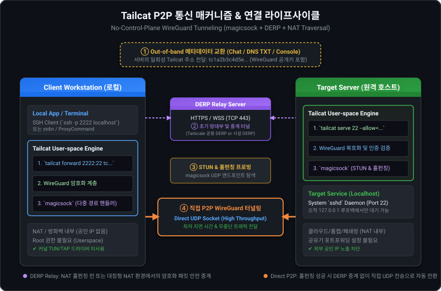
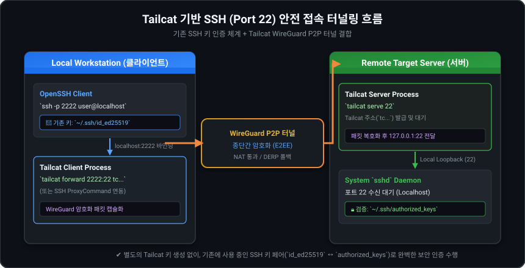

네트워크 엔지니어와 DevOps 엔지니어들에게 `netcat`(`nc`)은 지난 수십 년간 "네트워크의 스위스 아미 나이프"로 불려왔습니다. 두 호스트 간에 표준 입출력(stdin/stdout)을 파이프로 연결하고, 임의의 TCP/UDP 포트를 열고 닫으며, 방화벽 상태를 진단하고 임시 데이터 파이프라인을 구축하는 데 `netcat`만큼 직관적이고 강력한 도구는 없었습니다.

하지만 현대의 클라우드, 컨테이너, 홈랩 환경은 1990년대의 평면적인 네트워크와 전혀 다릅니다. 대부분의 인프라는 NAT(Network Address Translation) 뒤편에 격리되어 있고, 엄격한 방화벽과 사설 서브넷으로 둘러싸여 있으며, 평문 TCP 통신은 보안상 절대 허용될 수 없습니다.

**Tailscale**은 이러한 현대적 제약을 해결하기 위해 등장한 혁신적인 메시 VPN 서비스입니다. WireGuard 프로토콜을 기반으로 복잡한 방화벽 구성 없이 기기 간 풀 메시(Full Mesh) 암호화 터널을 뚫어줍니다. 

그런데 한 가지 질문이 남습니다. **"중앙 계정 로그인이나 제어 플레인(Control Plane), 관리자(root) 권한 없이, 오직 Tailscale의 순수한 데이터 플레인(Data Plane)과 NAT 통과 기술만 활용할 수는 없을까?"**

이 질문에 대한 Tailscale의 공식 해답이 바로 **Tailcat (`tailscale/tailcat`)**입니다.

이 글에서는 Tailcat의 탄생 배경과 `netcat`과의 철학적 공유점, 내부 통신 매커니즘, 그리고 서버의 22번 포트(`sshd`)를 안전하게 프록시하여 접속하는 실전 시뮬레이션 및 유용한 팁을 상세히 다룹니다.

---

## 1. Tailscale 간략 소개와 Tailcat의 탄생: netcat과의 아이디어 공유

### Tailscale의 기존 구조: 제어 플레인과 데이터 플레인

전통적인 **Tailscale** 환경은 두 가지 핵심 축으로 동작합니다.

1. **제어 플레인 (Control Plane, Tailscale Coordination Server):**
   * 사용자 인증(SSO/Google/GitHub 등), 기기 등록, ACL(접근 제어 목록), 각 노드의 공개키 및 IP 매핑 정보를 중앙에서 조정하고 배포합니다.
2. **데이터 플레인 (Data Plane):**
   * 커널 레벨 또는 유저스페이스의 WireGuard 암호화 엔진
   * 다양한 네트워크 환경에서 공인 IP 없이도 직접 피어(Peer)를 찾아 연결하는 **`magicsock`** (STUN, NAT 홀 펀칭 엔진)
   * 직접 P2P 연결이 불가능한 대칭형 NAT 환경을 지원하는 전 세계 분산 중계 서버 네트워크인 **DERP (Designated Encrypted Relay for Packets)**

Tailscale은 매우 훌륭하지만, 일회성 서버 디버깅, CI/CD 러너 간의 임시 파이프라인 구성, 또는 로그인 계정이나 중앙 관리 서버에 흔적을 남기고 싶지 않은 작업에서는 "계정 로그인" 자체가 병목이 되곤 합니다.

### Tailcat의 철학: `netcat`의 현대적 부활

`netcat`의 본질은 단순함입니다. 호스트 A에서 포트를 열고(`nc -l 1234`), 호스트 B에서 접속하면(`nc hostA 1234`), 두 프로세스의 표준 입출력이 네트워크를 통해 하나의 튜브처럼 이어집니다.

```bash
# 전통적인 netcat의 파이프라인 (공인 IP 필요, 암호화 없음, 방화벽 개방 필요)
Server: nc -l 8080
Client: nc 203.0.113.10 8080
```

그러나 전통적인 `nc`는 세 가지 치명적인 한계가 있습니다.
1. **공인 IP 또는 포트 포워딩 필수:** NAT나 공유기 뒤에 있는 서버는 외부에서 직접 접근할 수 없습니다.
2. **무암호화 (Cleartext):** 전송되는 모든 바이트가 평문으로 노출됩니다.
3. **인증 메커니즘 부재:** 포트가 열려 있으면 누구나 접속할 수 있습니다.

**Tailcat**은 이 전통적인 `netcat`의 아이디어를 **현대적인 암호화 및 P2P 기술로 재해석**했습니다.

| 비교 항목 | 전통적인 `netcat` (`nc`) | 현대의 `tailcat` |
| :--- | :--- | :--- |
| **인터페이스** | stdin/stdout 파이프, 소켓 바인딩 | stdin/stdout 파이프, 포트 포워딩, 파일/SSH 내장 |
| **암호화** | 없음 (평문 전송) | 기본 WireGuard 종단간 암호화 (E2EE) |
| **네트워크 제약** | 공인 IP 및 방화벽 포트 오픈 필수 | NAT 홀 펀칭 및 DERP 중계를 통한 무설정 통과 |
| **중앙 제어/계정** | 없음 (순수 P2P) | **없음 (Tailscale 계정·로그인 전혀 불필요)** |
| **권한 요구사항** | 저특권 포트 사용 시 일반 권한 가능 | **루트(root) 권한 불필요 (순수 Userspace Go 실행)** |
| **주소 식별자** | IP 주소 및 포트 번호 (`IP:PORT`) | 암호화된 일회성 문자열 (`tc...` 형식의 Tailcat 주소) |

Tailcat은 중앙 조정 서버(Control Plane)를 완전히 제거하고, 연결에 필요한 메타데이터(WireGuard 공개키 및 엔드포인트 힌트)를 암호화된 짧은 문자열(`tc...`)로 묶어 **Out-of-band(메신저, 터미널 복사, DNS 등)** 방식으로 교환하도록 설계되었습니다.

---

## 2. Tailcat 통신 매커니즘 및 주요 기능

### 핵심 통신 매커니즘과 연결 라이프사이클

Tailcat이 계정이나 중앙 데이터베이스 없이 전 세계 어디서든 방화벽을 뚫고 안전하게 연결되는 원리는 Tailscale의 검증된 오픈소스 라이브러리들(`wireguard-go`, `magicsock`, `derp`)의 결합에 있습니다.



통신은 다음 4단계의 라이프사이클을 거칩니다.

1. **① 일회성 키페어 생성 및 주소 교환 (Out-of-band Rendezvous)**
   * 서버에서 `tailcat`을 실행하면 메모리 상에 임시 WireGuard 키페어(비밀키/공개키)를 생성합니다.
   * 이 공개키와 초기 랑데부용 DERP 릴레이 힌트를 결합하여 `tc1...` 형태의 짧은 인코딩 주소를 생성합니다.
   * 사용자는 이 주소를 복사하여 접속할 클라이언트 터미널에 전달합니다.
2. **② DERP Relay를 통한 즉시 랑데부 및 초기 통신**
   * 클라이언트가 해당 주소로 접속을 시도하면, 두 노드는 먼저 전 세계에 분산된 Tailscale 공용 DERP 서버(HTTPS 443 포트)로 아웃바운드 연결을 맺습니다.
   * 이 단계에서 이미 패킷은 WireGuard로 종단간 암호화(E2EE)되어 있으므로 DERP 릴레이 서버조차 데이터 내용을 열람할 수 없습니다.
   * 포트가 열리기를 기다리지 않고 0.1초 만에 즉시 연결이 수립됩니다.
3. **③ `magicsock` 기반 NAT 홀 펀칭 (Hole Punching)**
   * 초기 트래픽이 DERP 릴레이를 통해 흐르는 동안, 양쪽 노드의 `magicsock` 엔진은 백그라운드에서 STUN 프로빙을 수행하여 서로의 공인 UDP 소켓 매핑 정보를 파악합니다.
   * 양측에서 서로를 향해 UDP 패킷을 발송하여 방화벽의 상태 추적 테이블(Stateful NAT Table)에 구멍을 뚫는 홀 펀칭을 시도합니다.
4. **④ 무중단 직접 P2P WireGuard 터널로 승격 (Seamless Upgrade)**
   * UDP 패킷이 성공적으로 맞닿는 즉시, `magicsock`은 트래픽 경로를 DERP 릴레이에서 직접 P2P UDP 소켓으로 매끄럽게 전환합니다.
   * 만약 한쪽이 엄격한 대칭형(Symmetric) 기업용 NAT에 갇혀 있어 홀 펀칭이 불가능하더라도, 끊김 없이 DERP 릴레이 경로를 유지하여 100% 접속 성공률을 보장합니다.

---

### Tailcat의 주요 기능 세트

Tailcat은 단순한 stdin/stdout 스트리밍 외에도 엔지니어들이 일상에서 필요로 하는 유용한 서브커맨드들을 내장하고 있습니다.

1. **원초적 입출력 파이프 (Raw Pipe):**
   * 서버: `tailcat`
   * 클라이언트: `tailcat <tailcat-address>`
   * 텍스트 스트리밍, 원격 명령 파이프(`tar czf - ./logs | tailcat <addr>`) 등에 활용됩니다.
2. **로컬 및 원격 포트 포워딩 (`serve` & `forward`):**
   * 서버의 임의 포트를 외부에 터널링하거나, 원격지에서 로컬 포트로 바인딩할 수 있습니다.
   * `tailcat serve 8080` / `tailcat forward 18080:8080 <tailcat-address>`
3. **웹 브라우징 지원 (`browse`):**
   * 원격 서버의 웹 서비스를 로컬 웹 브라우저에서 즉시 열어볼 수 있는 간이 프록시 모드입니다.
4. **간편한 파일 전송 (`recv` & `cp`):**
   * 임시 SFTP나 드롭박스 서버를 띄울 필요 없이, 수신 측에서 디렉토리를 열고(`tailcat recv ~/inbox`), 송신 측에서 파일이나 폴더를 전송(`tailcat cp data.tar.gz <tailcat-address>:`)합니다.
5. **네트워크 대역폭 및 성능 측정 (`perf`):**
   * `iperf3` 없이도 두 노드 간의 실제 대역폭과 왕복 지연 시간(RTT)을 측정할 수 있는 내장 성능 벤치마크 기능을 제공합니다.
6. **WebAssembly 브라우저 클라이언트:**
   * CLI 설치가 어려운 환경을 위해 브라우저 상에서 동작하는 WebAssembly 클라이언트(`tailscale.github.io/tailcat/`)를 제공하여 웹 브라우저와 CLI 간의 상호 통신이 가능합니다.

---

## 3. 실전 시뮬레이션: 서버의 SSH(22 포트) 안전하게 접속하기

가장 대표적이면서도 강력한 활용 사례는 **외부 공인 IP가 없거나 방화벽으로 완전히 막힌 원격 서버의 `sshd`(22번 포트)에 Tailcat을 통해 접속하는 것**입니다.

서버에 별도의 WireGuard나 OpenVPN 서버를 설치하지 않고, Tailcat 단일 바이너리만으로 22번 포트를 프록시하는 방법을 단계별로 살펴봅니다.



### 시나리오 A: 기존 SSH 키를 활용한 시스템 SSHD(22 포트) 안전 프록시 (권장)

이 방식의 가장 큰 장점은 **별도의 Tailcat 노드 키를 발급하거나 관리할 필요 없이, 개발자가 평소에 사용하던 기존 SSH 키(`~/.ssh/id_ed25519` 또는 `id_rsa`)를 그대로 재사용**한다는 점입니다.

서버의 OpenSSH 데몬(`sshd`)은 이미 `~/.ssh/authorized_keys`에 등록된 공개키로 인가를 검증하므로, Tailcat은 순수하게 방화벽과 NAT를 뚫어주는 **암호화된 P2P 전송 파이프(Transport)** 역할만 수행합니다. 이로써 복잡한 키 설정 없이 가장 단순하면서도 안전한 2단계 보안(WireGuard 터널 암호화 + SSH 비대칭키 인증)이 완성됩니다.

#### 1) 원격 서버: 22번 포트 Tailcat 프록시 실행
원격 서버 터미널에서 Tailcat으로 로컬 22번 포트를 수신 대기 상태로 올립니다.

```bash
# 서버의 22번 포트를 Tailcat P2P 터널로 오픈
tailcat serve 22
```

명령어를 실행하면 터미널에 고유한 일회성 Tailcat 주소가 출력됩니다.
```text
Listening on tc1qaa5x9y8z7w6v5u4t3s2r1q...
Share this address with the client.
```

> [!TIP]
> 만약 네트워크 트랜스포트 계층에서도 추가적인 화이트리스트 접근 제어를 걸고 싶다면 `--allow=nodekey:...` 옵션을 함께 지정할 수 있지만, 일반적인 경우에는 서버의 기존 `sshd`와 `authorized_keys` 인증만으로도 완벽한 보안이 보장됩니다.

#### 2) 로컬 클라이언트: 기존 SSH 키로 접속하기

**방법 1: `tailcat forward` 포트 포워딩 후 기존 SSH 키로 접속**
```bash
# 1. 로컬 2222 포트를 원격 서버의 22번 포트로 매핑 (백그라운드 실행)
tailcat forward 2222:22 tc1qaa5x9y8z7w6v5u4t3s2r1q... &

# 2. 로컬에 이미 존재하는 기존 SSH 키로 접속
ssh -i ~/.ssh/id_ed25519 -p 2222 ubuntu@localhost
```

**방법 2: OpenSSH `ProxyCommand`를 활용한 다이렉트 원클릭 접속 (`~/.ssh/config`)**
로컬 머신의 `~/.ssh/config`에 프록시 명령과 기존 키 경로(`IdentityFile`)를 한 번만 등록해 두면, 포트 포워딩 명령어 없이 평소 SSH 접속하듯 간편하게 바로 접속할 수 있습니다.

```sshconfig
# ~/.ssh/config 설정
Host tc-ssh
    User ubuntu
    IdentityFile ~/.ssh/id_ed25519
    ProxyCommand tailcat %h %p
```

설정 후에는 터미널에서 Tailcat 주소만 인자로 넘겨주면 즉시 접속됩니다.
```bash
ssh tc-ssh tc1qaa5x9y8z7w6v5u4t3s2r1q...
```

#### 📌 시나리오 A Quick Cheat Sheet (복사해서 바로 쓰기)

```bash
# [1] 원격 서버: 22번 포트 서빙 (주소 복사)
tailcat serve 22

# [2-A] 로컬 클라이언트: 백그라운드 포워딩 + 기존 SSH 키 접속
tailcat forward 2222:22 tc1qaa5x9y8z7w6v5u4t3s2r1q... &
ssh -i ~/.ssh/id_ed25519 -p 2222 ubuntu@localhost

# [2-B] 로컬 클라이언트: ~/.ssh/config ProxyCommand 원클릭 접속
# (~/.ssh/config 에 Host tc-ssh / ProxyCommand tailcat %h %p 등록 시)
ssh tc-ssh tc1qaa5x9y8z7w6v5u4t3s2r1q...
```

---

### 시나리오 B: 초간편 긴급 디버깅용 내장 SSH (`no-auth-ssh`)

원격 서버에 OpenSSH 데몬이 설치되어 있지 않거나, SSH 키를 설정하기 번거로운 긴급 컨테이너/임시 환경에서는 Tailcat 자체에 내장된 인증 생략형 SSH 셸을 즉시 띄울 수 있습니다.

> [!WARNING]
> `no-auth-ssh`는 SSH 자체의 비밀번호나 공개키 인증 과정을 완전히 건너뜁니다. 즉, **Tailcat 주소를 알고 있는 사람이라면 누구나 해당 터미널의 셸을 획득**할 수 있으므로, 단시간의 긴급 디버깅 용도로만 사용하고 완료 즉시 프로세스를 종료해야 합니다.

```bash
# 1. 원격 서버: 내장 SSH 서빙 시작
tailcat serve no-auth-ssh
# => Listening on tc1emergency12345...

# 2. 로컬 클라이언트: 별도 계정 입력 없이 즉시 대화형 셸 진입
tailcat ssh tc1emergency12345...
```

이 명령 한 번으로 NAT와 방화벽을 통과하여 즉시 원격 터미널 프롬프트가 열립니다.

#### 📌 시나리오 B Quick Cheat Sheet (1초 즉시 셸 진입)

```bash
# [1] 원격 서버: 내장 임시 SSH 셸 열기 (키/비밀번호 인증 생략)
tailcat serve no-auth-ssh
# 출력된 tc1emergency... 주소 복사

# [2] 로컬 클라이언트: 즉시 대화형 셸 접속
tailcat ssh tc1emergency...

# [3] 세션 종료 및 터널 즉시 파기
exit       # 클라이언트 세션 종료
Ctrl + C   # 서버 프로세스 종료 (임시 키와 터널이 영구 소멸)
```

---

### 시나리오 C: GitHub 공개키 기반 SSH 서버 오픈

`sshd` 설정 파일(`authorized_keys`)을 건드리지 않고, 특정 GitHub 유저의 공개키로만 로그인을 허용하고 싶을 때 매우 유용합니다.

```bash
# 원격 서버: GitHub 계정(예: octocat)의 공개키를 자동으로 가져와 인증하는 SSH 서비스 실행
tailcat serve --ssh-authorized-keys=github:octocat ssh
```

클라이언트 머신에서 GitHub 계정에 등록된 비공개키를 소유하고 있다면, 손쉽게 인증을 통과하여 셸에 진입할 수 있습니다.

---

## 4. 기타 실전 팁 및 엔지니어링 인사이트

### 1) 키 영속화(Key Persistence)로 고정 주소 유지하기
기본적으로 `tailcat`은 실행할 때마다 메모리 상에서 임시 키(Ephemeral Key)를 생성하므로, 프로세스를 재시작하면 주소 문자열(`tc...`)이 매번 변경됩니다.

지속적인 서비스나 자동화 파이프라인에서 고정 주소를 사용하려면 키를 파일로 저장해 유지해야 합니다.

```bash
# 서버 전용 고정 키 생성
tailcat genkey > /etc/tailcat/server.key
chmod 600 /etc/tailcat/server.key

# 고정 키를 사용하여 서빙 (재부팅 후에도 tc... 주소가 변하지 않음)
tailcat --key-file /etc/tailcat/server.key serve 22
```

### 2) DNS TXT 레코드를 활용한 도메인 주소 매핑
복잡하고 긴 `tc1qaa5x9y...` 문자열을 매번 메신저나 슬랙으로 주고받는 것이 번거롭다면, 자신이 소유한 도메인의 DNS TXT 레코드에 등록할 수 있습니다.

* **DNS 설정:**
  * 호스트: `bastion.example.com`
  * 타입: `TXT`
  * 값: `tailcat=tc1qaa5x9y8z7w6v5u4t3s2r1q...`

클라이언트에서는 긴 문자열 대신 도메인 주소를 그대로 사용할 수 있습니다.
```bash
tailcat forward 2222:22 bastion.example.com
```

> [!IMPORTANT]
> DNS TXT 레코드는 공개적으로 조회 가능하므로 누구나 해당 Tailcat 주소를 열람할 수 있습니다. 따라서 DNS 연동 시에는 반드시 서버 실행 시 `--allow=nodekey:...` 옵션을 지정하여 허가된 클라이언트 노드만 연결을 수립할 수 있도록 엄격히 제한해야 합니다.

### 3) 독립적인 유저스페이스(Userspace) 동작과 Tailscale 공존성
* **Root 권한 불필요:** Tailcat은 Linux 커널의 TUN/TAP 가상 인터페이스를 생성하지 않고 순수 유저스페이스 Go 프로그램 내에서 소켓을 직접 다룹니다. 따라서 Docker 컨테이너나 권한이 제한된 공유 서버에서도 `sudo` 없이 바로 실행됩니다.
* **기존 Tailscale과의 무간섭 공존:** 호스트에 이미 공식 `tailscaled` 데몬이 구동 중이더라도, Tailcat은 자체 독립 포트와 메모리 상의 네트워킹 스택을 사용하므로 기존 Tailnet 설정이나 라우팅 테이블과 일절 충돌하지 않습니다.

### 4) 폐쇄망 및 사설 DERP 중계 서버 운용
Tailcat은 기본적으로 Tailscale이 전 세계에 무료로 제공하는 DERP 서버들을 활용합니다. 하지만 금융망, 국방망, 혹은 완벽한 폐쇄망 환경에서는 외부 인터넷의 공용 DERP에 연결할 수 없습니다.

이 경우 사내 인프라에 독자적인 DERP 서버를 배포한 뒤 플래그를 통해 사설 DERP 주소를 명시할 수 있습니다.
```bash
tailcat --derp-server=https://derp.internal.mycompany.com serve 22
```

---

## 5. 마치며: 임시 네트워크 터널링의 새로운 표준

Tailcat은 "중앙 관리형 VPN"과 "원초적인 소켓 도구" 사이의 간극을 완벽하게 메워주는 도구입니다.

* **임시 컨테이너나 클라우드 인스턴스에 즉시 접속해야 할 때**
* **NAT 뒤에 있는 개발용 DB 포트나 로컬 웹 서비스를 동료에게 안전하게 시연할 때**
* **복잡한 VPN 클라이언트 설치나 방화벽 예외 신청 없이 긴급 터널이 필요할 때**

Tailcat은 WireGuard의 강력한 암호화와 `magicsock`의 경이로운 NAT 통과 능력을 단 하나의 경량 바이너리에 담아 제공합니다. 

현대적인 DevOps 인프라 환경에서 빠르고 안전한 네트워크 파이프라인을 구축해야 한다면, 여러분의 터미널 도구 상자에 `tailcat`을 추가해 보시길 강력히 추천합니다.
